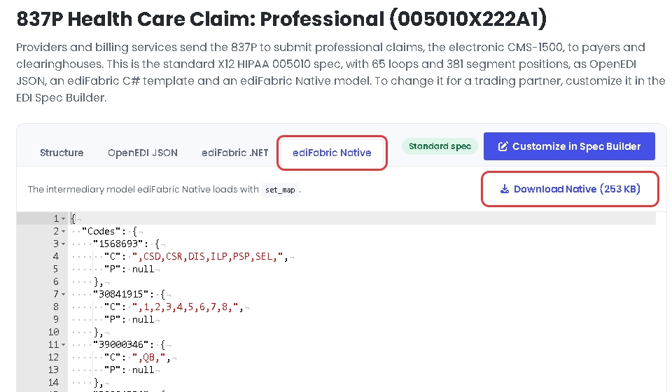
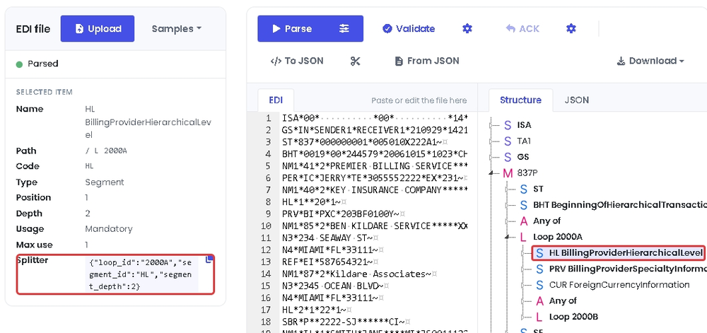

# ediFabric Native X12 - Node.js bindings

**ediFabric Native** is a self-contained, high-performance X12 EDI native shared library. It converts X12 EDI to JSON (and back),
validates transaction sets, and generates acknowledgments — callable from **any
language with a C foreign-function interface** (C, C++, Rust, Go, Python, Node.js,
Java/JNA, .NET, …). No .NET runtime, JVM, or other dependency is required on the
target machine.

Node.js bindings for [ediFabric Native](https://www.edifabric.com/edifabric-native.html), built on the [koffi](https://koffi.dev) FFI.

| File | Purpose |
| --- | --- |
| `edifabric-x12.js` | koffi bindings for the complete C ABI |
| `edifabric-x12.d.ts` | TypeScript declarations for the bindings |
| `example_all_functions.js` | runnable walkthrough of every entry point |
| `c-abi-edifabric_x12_tools.h` | the C header these bindings mirror |
| `PUBLISHING.md` | how the npm packages are built and published |

## Install

```bash
npm install edifabric-x12
```

npm also installs the ediFabric Native library for your platform from one of the
`@edifabric/x12-<os>-<cpu>` packages, so there is nothing else to download. They are
published for Windows x64, Linux x64 and arm64 (glibc 2.34 or later), and macOS
arm64 (12 or later). A library you pass to `loadLibrary(path)`, set in
`EDIFABRIC_X12_LIB`, or put in the working directory takes precedence over the
bundled one.

## Requirements

- Node.js 18 or later
- [koffi](https://www.npmjs.com/package/koffi), installed with `npm install` (prebuilt, no compiler needed)
- 64-bit Windows, Linux, or macOS
- The native library for your platform (installed from npm with the package; download it when you run from a clone):

| Platform | File |
| --- | --- |
| Windows | `edifabric-x12-tools.dll` |
| Linux | `edifabric-x12-tools.so` |
| macOS | `edifabric-x12-tools.dylib` |

1. [Sign up free for **Community**](https://www.edifabric.com/pricing.html) to get an evaluation serial key. Community never expires, requires no credit card, and is for non-production use. The first 14 days after you subscribe have unlimited operations, then the quota is 250 per day. To extend the unlimited period, ask through the [support portal](https://support.edifabric.com/hc/en-us/requests/new) or at [support@edifabric.com](mailto:support@edifabric.com). After signup, retrieve your serial from [Your Account](https://www.edifabric.com/docs/getting-started/your-account.html).
2. [Download the **ediFabric Native** library](https://www.edifabric.com/docs/edifabric-native/download.html).

Plus your **model files** (per transaction set) and a **map file** that tells the
engine where to find them. See [Model map](#model-map) for details.

## Getting started

**Sign up free for Community** at [edifabric.com/pricing](https://www.edifabric.com/pricing.html)
to get an evaluation serial key, then **download the library** from
[here](https://www.edifabric.com/docs/edifabric-native/download.html).
Put the native library beside `edifabric-x12.js`, install the dependency, then run the walkthrough with your serial:

```bash
npm install
node example_all_functions.js --serial YOUR_SERIAL
```

It authorizes with your Community (or paid) serial, loads the model map, and
calls every function in the ABI, printing what each one returns.

```
======================================================================
Parse: parse (mode 2, JSON + validation report)
======================================================================
  8711 chars total, validation starts at offset 8556
  validation -> {"errors":[{"index":9,"element_index":2,"composite_index":1,"repetition_index":1,"code":17,"message":"Invalid EDI code"}],"errors_count":1,"data_count":46}
```

Options:

```bash
node example_all_functions.js --serial YOUR_SERIAL   # Community or paid serial (required)
node example_all_functions.js --lib /opt/edifabric   # library file or folder
```

You can also set `EDIFABRIC_SERIAL` instead of passing `--serial`.

The library path is resolved from `--lib`, then `EDIFABRIC_X12_LIB`, then the
module folder, its parent, the working directory, and the library bundled in the
`@edifabric/x12-<os>-<cpu>` package. The serial comes from
`--serial`, then `EDIFABRIC_SERIAL`.

All strings and payloads cross the boundary as **UTF‑8 byte buffers**
(`pointer + length`). Every function returns `0` on success or a non-zero
[error code](#error-codes).

## Usage

```js
const fs = require('fs');
const ef = require('./edifabric-x12');   // or: import ef from './edifabric-x12.js';

const serial = 'your-serial';   // from your Community or paid plan

ef.loadLibrary();                  // or ef.loadLibrary('C:\\libs\\edifabric-x12-tools.dll')
ef.setSerial(serial);              // Community: setSerial. Developer: prefer ensureToken. Enterprise: prefer setToken.
ef.setMap(JSON.stringify({ default: serial, maps: {} }));

const edi = fs.readFileSync('purchase-order.edi');
const { output: transactions } = ef.parse(edi, ef.ParseMode.JSON);
console.log(transactions);
```

Inputs accept a string or a `Buffer` (any `TypedArray` or `ArrayBuffer` also works).
Read a file from a subfolder of the script:

```js
const path = require('path');

const edi = fs.readFileSync(path.join(__dirname, 'edi', '837p.txt'));
```

### Validation and acknowledgments

`parse` returns `{ output, offset }`. In modes 2 and 3, `offset` marks where the
validation and acknowledgment JSON starts inside the output. It is a string index,
so `output.slice(offset)` is safe even when the data contains non-ASCII characters.

```js
const config = JSON.stringify({
    validate: { snip_level: 2, max_errors: 0 },
    ack: { gen997: false, supress_ta1: false },
});

const { output, offset } = ef.parse(edi, ef.ParseMode.JSON_VALIDATE_ACK, config);
const transactions = output.slice(0, offset);
const report = JSON.parse(output.slice(offset));
console.log(report.errors_count, report.ack);
```

| Mode | Constant | Output |
| --- | --- | --- |
| 1 | `ParseMode.JSON` | transaction-set JSON |
| 2 | `ParseMode.JSON_VALIDATE` | JSON plus a validation report |
| 3 | `ParseMode.JSON_VALIDATE_ACK` | JSON plus validation and a 999/997/TA1 acknowledgment |

### Streaming large interchanges

`iterSplit` streams one transaction set (or repeating loop) at a time with flat
memory use. `segment_id` must be `ST` or the first segment of a repeating loop.

```js
const config = JSON.stringify({ split: { segment_id: 'LX', segment_depth: 6, loop_id: '2400' } });

for (const { payload, offset, isLast } of ef.iterSplit(edi, ef.ParseMode.JSON, config)) {
    handle(JSON.parse(payload.toString('utf8')));
}
```

`iterMerge` streams a full interchange JSON document back out one segment at a time:

```js
const out = fs.openSync('out.edi', 'w');
for (const segment of ef.iterMerge(transactions)) {
    fs.writeSync(out, segment);
    fs.writeSync(out, '\r\n');
}
fs.closeSync(out);
```

Both wrap the underlying `startSplit`/`split`/`getResult` and
`startMerge`/`merge`/`getResult` sequences, which you can also drive directly.

### Building EDI

```js
const ediText = ef.build(transactions, '\r\n');   // postfix null for compact output
```

## API reference

Conventions used by every function:

- Returns `int`: `0` = success, non-zero = [error code](#error-codes).
- Inputs are UTF‑8 `byte*` + `int length`.
- Output functions use **grow-and-retry**: if the buffer is too small the call
  returns `1` (`InsufficientCapacity`) and writes the required size into the
  length out-parameter; reallocate and call again.
- Exceptions never cross the boundary.

Every wrapper throws `EdiFabricError` when the native call returns a non-zero
status; it carries `code`, `nativeMessage`, and `api` (the C function name).
Buffer growth (`InsufficientCapacity`) is retried automatically. The wrappers use
camelCase names; the C functions keep their ABI names on `loadLibrary().raw`.

| Group | Functions |
| --- | --- |
| Loading | `loadLibrary` |
| Lifecycle | `initLogger`, `shutdownLogger`, `clearCache` |
| Licensing | `ensureToken`, `getAppVersion`, `getToken`, `validateToken`, `setToken`, `getTokenExpiration`, `setSerial` |
| Model map | `setMap` |
| Processing | `parse`, `startSplit`, `split`, `build`, `startMerge`, `merge`, `getResult` |
| Errors | `getError`, `freeError`, `decodeString`, `check` |
| Wrappers | `iterSplit`, `iterMerge` |
| Constants | `ParseMode`, `LogLevel`, `ErrorCode`, `EdiFabricError` |

`getError` frees the native string for you. Call `freeError` only if you
invoke the raw export yourself (`loadLibrary().raw.get_error(code)` returns a
pointer; read it with `decodeString`). Builds that do not export `free_error` fall
back to the C runtime `free`.

`getTokenExpiration` returns a `BigInt`, because .NET ticks don't fit in a
JavaScript number. `getResult`, `iterSplit`, and `iterMerge` return `Buffer`s;
call `.toString('utf8')` for text.

## Licensing

> [!NOTE]
> Sign up free for the [Community plan](https://www.edifabric.com/pricing.html)
> to get an evaluation serial key. Community never expires, requires no credit
> card, and is for non-production evaluation, learning, and prototyping
> (unlimited operations for the first 14 days after you subscribe, then 250 per day;
> to extend the unlimited period, ask through the [support portal](https://support.edifabric.com/hc/en-us/requests/new)
> or at [support@edifabric.com](mailto:support@edifabric.com)). After signup, copy your serial from
> [Your Account](https://www.edifabric.com/docs/getting-started/your-account.html).
>
> If you hit the Community daily quota, native calls return [error 639](#error-codes);
> upgrade at [edifabric.com/pricing](https://www.edifabric.com/pricing.html) if you
> want to continue.

| Plan | What works | Recommended |
| --- | --- | --- |
| Community | `setSerial` only | `setSerial` |
| Developer | `setSerial` and `ensureToken` (`ensureToken` caches the result for 1 day) | `ensureToken` |
| Enterprise | `setSerial`, `ensureToken`, `getToken` / `setToken` | `setToken` (offline tokens) |

```js
// Community: authorize per process against the license server
ef.setSerial(serial);

// Developer (recommended): 1-day built-in cache; refreshes if the token expires within N seconds
ef.ensureToken(serial, 3600);
console.log(ef.getTokenExpiration());   // .NET UTC ticks as BigInt, 0n when unset

// Developer (also works): same as Community, online check per process
ef.setSerial(serial);

// Enterprise (recommended): fetch / validate / set an offline token yourself
const token = ef.getToken(serial);
ef.validateToken(token);
ef.setToken(token);
```

## Model map

`setMap` tells the engine where to find transaction-set models. Keys are
`message:version`. Set `default` to your serial to resolve unmapped transaction
sets through the online spec service, or leave it `null` (or `""`) and map
everything locally.

The example builds that JSON at runtime instead of hard-coding paths. Online
fallback is an object with `default` set to your serial:

```js
ef.setMap(JSON.stringify({ default: serial, maps: {} }));
```

For local models, load a map file and rewrite each entry's `location` to the
folder that actually holds the JSON files (see `loadLocalMap` in
`example_all_functions.js`):

```js
const mapPath = path.join(__dirname, 'map', 'map.json');
const localMap = JSON.parse(fs.readFileSync(mapPath, 'utf8'));
for (const entry of Object.values(localMap.maps || {})) {
    entry.location = path.dirname(mapPath);
}

ef.setMap(JSON.stringify(localMap));
```

`map.json` lists each transaction set; `location` is filled in at runtime so the
same file works from any working directory:

```json
{
  "default": "",
  "maps": {
    "837:005010X222A1": { "type": 1, "name": "model837P.json", "location": "" },
    "834:005010X220A1": { "type": 1, "name": "model834.json",  "location": "" }
  }
}
```

You can also mix both: keep `default` as your serial and add local entries under
`maps` for the transaction sets you ship on disk.

All X12 transactions, such as 837P, 834 and 850, are represented as ediFabric Native JSON models. The models are the same on every plan, Community or paid.

**Standard models** come from the [EDI spec library](https://www.edifabric.com/specs/index.html), and you can download them without an account. Open the transaction, for example [837P](https://www.edifabric.com/specs/x12/hipaa/005010/837p.html), and on the **ediFabric Native** tab select **Download Native**.



**Custom models** come from the [EDI Spec Builder](https://www.edifabric.com/spec-builder/index.html). When a trading partner changes the standard, open the transaction in the EDI spec library and select **Customize in Spec Builder**, or import your own OpenEDI file. Edit the OpenEDI schema until it matches the partner's guide and select **Update**. Then, on the **ediFabric Native** tab, select **Download Native**.


Save the downloaded file where the map can name it, and add it to `maps` under its `message:version` key, for example `837:005010X222A1`. The file is the compiled layout the engine loads, not the OpenEDI schema. To change a model, edit the spec in the EDI Spec Builder and download it again. See [EDI models](https://www.edifabric.com/docs/edifabric-native/edi-models.html) and [OpenEDI format](https://www.edifabric.com/docs/getting-started/openedi-format.html).

## Configuration JSON

All JSON uses **`snake_case`** keys and is case-insensitive.

### ParseConfig (`parse`)

```json
{
  "validate": { "regex": null, "date_format": null, "time_format": null,
                "skip_seq_count": false, "skip_hl_seq": false,
                "snip_level": 0, "max_errors": 0 },
  "ack":      { "supress_ta1": false, "ak901p": false,
                "gen_for_valid": false, "gen997": false }
}
```

- `validate` — applied when `mode ≥ 2`; `snip_level` is `1`–`4`.
- `ack` — applied when `mode == 3`.

All sections are optional for `parse`.

### SplitConfig (`startSplit`)

```json
{
  "split":    { "segment_id": "ST", "segment_depth": 0, "loop_id": null }
}
```

- `split` — required for `startSplit`.

Splitting is possible for the following boundaries:

- Transaction - for files that contain batches of transactions.
- Repeating loop - for files that contain batches of loops, such as order lines, claims or benefit enrollments.

The splitter must be configured as follows:

- `segment_id`  — the name of the segment to split by. It must be either ST or the first segment in the repeatable loop (Mandatory).
- `segment_depth` — the depth of the segment in the model hierarchy (Mandatory).
- `loop_id` — the name of the loop for the segment specified in segment_id (Optional).

The values for the splitter are in [EdiNation](https://edination.edifabric.com/), the free X12 editor. Load a file, select **Parse**, and select the first segment of the loop in the **Structure** tab. For example, to split an 837P by loop 2000A, load the 837P sample from **Samples** and select the **HL** segment in loop 2000A. Under **Selected item**, `segment_id` is **Code**, `loop_id` is the last item in **Path**, and `segment_depth` is **Depth**.

> [!NOTE]
> If a segment shows no **Splitter**, the file can't be split by that segment.

The easiest way to get the splitter configuration is to select the copy button next to **Splitter**, which copies the three values as JSON. Paste them as the value of `split`.



## Threading

The calls are synchronous and run on the calling thread. The library holds
process-global state (model map, active split reader, active merge writer, last
result, license) behind an internal lock. `parse` and `build` are independent per
call, but each split or merge sequence must run to completion without another
split or merge interleaving from a different thread. Each `worker_threads` worker
shares the same process-global state.

## Error codes

`0` is success and `1` means the output buffer was too small. Library-level codes
are exposed as `ErrorCode`, and `getError(code)` returns the message.
Validation codes (elements, segments, transaction sets, groups, and interchanges)
appear in the parse report when `mode ≥ 2`.

**Error 639** means the Community (evaluation) daily quota was exceeded.
Upgrade your plan at [edifabric.com/pricing](https://www.edifabric.com/pricing.html)
if you wish to continue.

### Parser and library

| Code | Meaning |
| --- | --- |
| 1 | The suggested output buffer size is too small |
| 501 | Unexpected error. Contact support@edifabric.com and include a sample project/file to reproduce the issue |
| 502 | No connection to EdiNation API |
| 503 | The model map configuration is invalid. Check the paths and the model file names are correct |
| 611 | The input buffer is either null or its size is nill |
| 612 | The logger failed to log |
| 613 | The map configuration file is invalid |
| 614 | The output capacity must be positive |
| 615 | Models map must be set before parsing or splitting |
| 616 | Mode must be any of: 1 - Parse, 2 - Parse and Validate, 3 - Parse and Validate and Acknowledge |
| 617 | Parser failed. Contact support@edifabric.com and include a sample project/file to reproduce the issue |
| 618 | Validation failed. Contact support@edifabric.com and include a sample project/file to reproduce the issue |
| 619 | Validation serializer failed. Contact support@edifabric.com and include a sample project/file to reproduce the issue |
| 620 | The token is invalid. Contact support@edifabric.com for assistance |
| 621 | The configuration file is invalid |
| 622 | The split segment ID must not be blank |
| 623 | Call `startSplit` before splitting |
| 624 | The result can't be retrieved. Contact support@edifabric.com and include a sample project/file to reproduce the issue |
| 625 | Result buffer size mismatched |
| 626 | Call `startMerge` before merging |
| 627 | The output buffer is either null or its size is nill |
| 628 | The serial number is missing or incorrect. `getToken` doesn't work with Developer license |
| 629 | License was not installed. Contact support@edifabric.com for assistance |
| 630 | No license to use this version. Contact support@edifabric.com for assistance |
| 631 | The token has expired. Get and set a new token to continue |
| 632 | The token is missing. Set token to continue |
| 633 | Reached the maximum number of licenses. Set token to continue |
| 634 | Environment not recognized for licensing or reached the maximum number of licenses |
| 635 | Serial or token not found. Either set token or serial to continue |
| 636 | The rate to get serials was exceeded for your license. Wait for 60 seconds and try again or upgrade your license |
| 637 | Invalid JSON. Enable logging for additional details |
| 638 | The operation is not supported by your license |
| 639 | Community daily quota exceeded. Your license has reached its daily call limit. Upgrade your plan at edifabric.com to continue |

## Troubleshooting

**`Error: Could not load edifabric-x12-tools.dll`** — the library is
not on any searched path. Pass `ef.loadLibrary('/path/to/library')` or set
`EDIFABRIC_X12_LIB`. If the message ends with `Cannot find function ... in shared library`,
the library is older than these bindings; download the current build.

**`Cannot find module 'koffi'`** — run `npm install` in this folder.

**Error 615 on parse** — call `setMap` before parsing or splitting. `clearCache`
resets the map, so reload it afterwards.

**Error 628 / 635 on parse** — authorize first: `setSerial` on Community,
`ensureToken` (or `setSerial`) on Developer, or `setToken` on Enterprise.

**Error 633 on ensureToken / getToken** — the plan's machine quota is used up.
Contact support.

**Error 639** — the Community (evaluation) daily quota was exceeded. Wait until
the next day, or [upgrade your plan](https://www.edifabric.com/pricing.html) if
you wish to continue.

## Links

- [Documentation](https://www.edifabric.com/docs/edifabric-native/introduction.html)
- [Product page](https://www.edifabric.com/edifabric-native.html)
- [Community plan (free signup)](https://www.edifabric.com/pricing.html)
- [Your Account](https://www.edifabric.com/docs/getting-started/your-account.html)
- Support: support@edifabric.com
